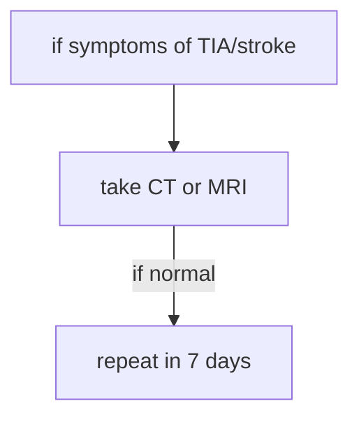
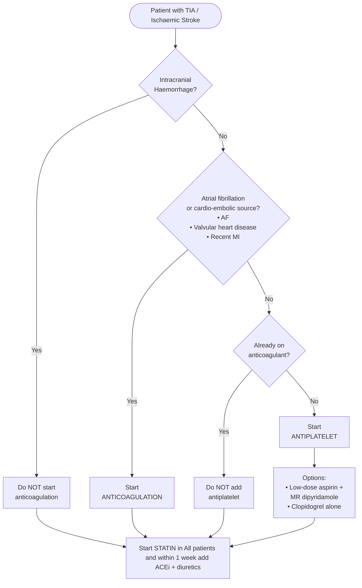

## risk factors 
### major
1. [SHTN](SHTN.md)
	1. especially systolic
2. smoking
3. cardiovascular disease
	1. carotid artery stenosis
4. [arrythmias](arrythmias.md) (especially valvular)
### others
1. cardiac failure
2. dyslipidaemia
3. obesity
4. alcohol excess
5. oral contraception
6. migraine
7. stress.

# stroke
## definition
1. rapidly developing symptoms and/or signs of focal (or global) loss of brain function lasting longer than 24 hours or leading to death with no apparent cause other than of vascular origin
2. stroke in evaluation
	1. An enlarging neurological deficit, presumably due to infarction, which increases over 24–48 hours.

## pathophysiology
### pathogenesis
1. single penetrator or small vessel disease (lacunar syndrome)—probably due to in situ small vessel disease
2. cardio–emboli (heart to artery embolism)
3. large vessel artery-to-artery embolic infarcts

### causes
- **Stroke types distribution**
  - **Haemorrhagic stroke 15%**
    - Primary intracerebral haemorrhage 10%
    - Subarachnoid haemorrhage SAH 5%
  - **Ischaemic stroke 85%**
    - Large vessel artery to artery embolism 30%
    - Cardio embolic 20%
    - Small vessel lacunar infarcts 15%
    - Uncertain type 15%
    - Rare venous infarction 5%


## diagnosis
1. if PFO in young people
	1. suspect cryptogenic stroke
		1. do ECHO and treat with percutaneous closure device
2. if heart murmur
	1. [infective endocarditis](infective%20endocarditis.md)
3. sudden stroke
	1. typically embolsim
4. if cerebral haemorrhage
	1. evolve over hours
	2. mostly on putamen
### pitfalls
1. Mistaking visual or sensory migraine equivalents in young adults for TIAs
2. Mistaking a CVA for labyrinthitis (rare over 50 years)
3. Failure to perform carotid duplex Doppler ultrasound or CT scan before starting aspirin for TIA or small stroke (because of missing small haemorrhage, unsuspected tumour or a subdural)
4. Diagnosing small stroke as a lacuna (may be a stroke in evolution)

| Artery                                   | Area of lesion                                                                                                                                         | Symptoms                                                                                                                                                                                                                                                                                                             | Notes                                                                                                                                    |
| ---------------------------------------- | ------------------------------------------------------------------------------------------------------------------------------------------------------ | -------------------------------------------------------------------------------------------------------------------------------------------------------------------------------------------------------------------------------------------------------------------------------------------------------------------- | ---------------------------------------------------------------------------------------------------------------------------------------- |
| **Anterior cerebral artery**             | Motor and sensory cortices of lower limb                                                                                                               | Contralateral paralysis and sensory loss of lower limb, urinary incontinence                                                                                                                                                                                                                                         | —                                                                                                                                        |
| **Middle cerebral artery**               | Motor and sensory cortices of face and upper limb<br>Frontal lobe Broca area<br>Temporal lobe Wernicke area                                            | Contralateral paralysis and sensory loss of face and upper limb<br>Aphasia if dominant hemisphere involved<br>Hemineglect if nondominant hemisphere involved                                                                                                                                                         | Wernicke aphasia often associated with right superior quadrantanopia due to temporal lobe involvement                                    |
| **Lenticulostriate artery**              | Striatum, internal capsule                                                                                                                             | Contralateral paralysis                                                                                                                                                                                                                                                                                              | Pure motor stroke<br>Absence of cortical signs such as aphasia or neglect<br>Common site of lacunar infarcts due to chronic hypertension |
| **Posterior cerebral artery**            | Occipital lobe                                                                                                                                         | Contralateral homonymous hemianopia with macular sparing<br>Alexia without agraphia if dominant hemisphere involved<br>Prosopagnosia if nondominant hemisphere involved                                                                                                                                              | Lesion may extend to splenium of corpus callosum                                                                                         |
| **Basilar artery**                       | Pons, medulla, lower midbrain<br>Corticospinal and corticobulbar tracts<br>Ocular cranial nerve nuclei                                                 | Quadriplegia<br>Loss of voluntary facial, mouth, and tongue movements<br>Loss of horizontal eye movements                                                                                                                                                                                                            | Consciousness preserved if reticular activating system spared<br>Locked-in syndrome                                                      |
| **Posterior inferior cerebellar artery** | Nucleus ambiguus CN IX X XI<br>Vestibular nuclei<br>Spinothalamic tract<br>Spinal trigeminal nucleus<br>Inferior cerebellar peduncle                   | Dysphagia, hoarseness, absent gag reflex, hiccups<br>Vertigo, vomiting, nystagmus<br>Loss of pain and temperature from contralateral body and ipsilateral face<br>Ipsi­lateral Horner syndrome<br>Ipsi­lateral ataxia                                                                                                | Lateral medullary Wallenberg syndrome<br>Nucleus ambiguus involvement is specific                                                        |
| **Anterior spinal artery**               | Corticospinal tract<br>Medial lemniscus<br>Hypoglossal nerve nucleus                                                                                   | Contralateral paralysis of upper and lower limbs<br>Loss of contralateral proprioception<br>Ipsi­lateral tongue deviation                                                                                                                                                                                            | Medial medullary syndrome<br>Due to infarct of paramedian branches                                                                       |
| **Anterior inferior cerebellar artery**  | Facial nerve nucleus<br>Vestibular nuclei<br>Spinothalamic tract<br>Spinal trigeminal nucleus<br>Middle and inferior cerebellar peduncles<br>Inner ear | Ipsi­lateral facial paralysis LMN type<br>Reduced lacrimation salivation and taste from anterior two thirds of tongue<br>Vertigo, vomiting, nystagmus<br>Loss of pain and temperature from contralateral body and ipsilateral face<br>Ipsi­lateral Horner syndrome<br>Ipsi­lateral ataxia and sensorineural deafness | Lateral pontine syndrome<br>Facial nerve involvement is specific<br>Supplied via labyrinthine artery                                     |

	1. 

### lacunar CVA
1. small, deep infarcts
2. pure motor hemiplegia
3. most common effect
4. lack of cortical signs
5. the neurological deficit may progress over 24–36 hours
6. outcome usually good

## management
# 🧠 Acute Stroke Management – ED / AMC Checklist

---

## 1️⃣ Immediate Stabilization (ABC)
- Stabilize **Airway, Breathing, Circulation**
- Assess **GCS**
- Check **capillary blood glucose**

### Oxygen
- If **SpO₂ < 94%**
  - Give supplemental oxygen

---

## 2️⃣ Exclude Immediate Mimics / Threats
- Exclude **head trauma**
- Treat immediately reversible causes:
  - Seizures → [[seizures]]
  - Hypoglycemia

---

## 3️⃣ Neuroimaging (URGENT)
- Obtain **non-contrast CT brain**
  - Thin slice (≈ **2 mm**)
- OR **MRI brain**
  - MRI is **more sensitive & specific**
  - **Urgency > modality choice**

---

## 4️⃣ Supportive Care
- Nil by mouth (**NBM**) until swallow assessed
- Give:
  - IV fluids
  - Electrolyte correction
  - Nutritional support

---

## 5️⃣ Blood Pressure Management
- **Hypertension increases stroke risk ×6**

### Ischemic Stroke (Pre-thrombolysis)
- Target before tPA:
  - **SBP < 185 mm Hg**
  - **DBP < 110 mm Hg**
- First-line agents:
  - IV **Labetalol**
  - IV **Nicardipine**

### Hemorrhagic Stroke
- If **SBP 150–220 mm Hg**
  - Lower SBP to **~140 mm Hg**
  - Safe and may improve functional outcome

---

## 6️⃣ Vascular Evaluation
- **Carotid duplex Doppler**
  - Indicated for **carotid territory symptoms**

---

## 7️⃣ Hemorrhagic Stroke Management
- **No proven medical therapy** for hemorrhagic CVA

### Intracerebral Hemorrhage (ICH)
- Consider **urgent (<6 hours) surgical evacuation** for:
  - Posterior fossa (cerebellar) hematoma
  - Large cerebral white-matter hematoma
- **Shunt insertion** may be required

### Subarachnoid Hemorrhage (SAH)
- Requires **urgent neurosurgical referral**
- Major risks:
  - Vasospasm
  - Rebleeding
- Treatment:
  - **Nimodipine**
  - ± Surgical intervention

---

## 8️⃣ Ischemic Stroke – Antiplatelet & Thrombolysis

### Aspirin
- Give **Aspirin 150–300 mg orally**
  - Within **48 hours**
  - Only after CT/MRI excludes hemorrhage
  - If thrombolysis or other anticoagulants are **not used**

### Thrombolysis (tPA)
- Eligible if within **4.5 hours** of onset
  - Earlier = better outcome
- **Alteplase** improves outcomes
  - Streptokinase ❌ (not recommended)
- Risks:
  - **5–7% intracerebral hemorrhage**
  - Slight ↑ early mortality

---

## 9️⃣ Thrombolytic Regimens
- **Alteplase**
  - Dose: **0.9 mg/kg** (max **90 mg**)
  - 10% IV bolus
  - Remaining 90% over **1 hour**
- **Tenecteplase**
  - Dose: **0.25 mg/kg**
  - Max **25 mg**
- After thrombolysis:
  - **Withhold aspirin for 24 hours**

### Avoid in Acute Stroke
- ❌ Steroids
- ❌ Mannitol
- ❌ Haemodilution
- ❌ Anticoagulation

---

## 🔟 Detailed Medication Guidance

### Acute Ischemic Stroke
- IV tPA:
  - FDA-approved: **0–3 hours**
  - Extended window: **up to 4.5 hours**
    - With stricter criteria
- Must discuss:
  - **Benefit vs risk**
  - With patient and family
- Do **NOT** give anticoagulation in first **24 hours**
- Start **oral aspirin at 24–48 hours**
  - Regardless of thrombolysis status

### Hemorrhagic Stroke + Anticoagulation
- If elevated **INR**:
  - IV **Vitamin K**
  - Vitamin K–dependent clotting factors
- Factor Xa inhibitors / direct thrombin inhibitors:
  - Individualized reversal
  - Based on agent availability & hospital protocol

### Transient Ischemic Attack (TIA)
- Mainstay: **Antiplatelet therapy**
- Start within **24 hours**
- Options:
  - Aspirin monotherapy
  - Aspirin + extended-release dipyridamole
  - Aspirin + clopidogrel

---

## 1️⃣1️⃣ Endovascular (Non-Pharmacologic) Therapy

### Mechanical Thrombectomy
- Eligible if **within 6 hours**
- **CTA should NOT delay tPA**

### Eligibility Criteria (ALL required)
- Pre-stroke mRS: **0–1**
- Received tPA within 4.5 hours (if eligible)
- Occlusion of:
  - Proximal MCA **or**
  - Internal carotid artery
- Age **≥ 18 years**
- NIHSS **≥ 6**
- ASPECTS **≥ 6**
- Able to undergo procedure within **6 hours**

### Logistics
- If eligible but facility lacks capability:
  - **Urgent transfer** to thrombectomy-capable center

---
### 🧠 Eligibility for Thrombolysis (IV tPA)

---

## ⏱️ Time Window: < 3 Hours

### ✅ Eligibility Criteria
- Age **≥ 18 years**
- Clinical diagnosis of **ischemic stroke**
  - Causing **measurable neurological deficit**
- **Non-contrast CT brain**
  - Shows **NO intracranial hemorrhage**
- Clearly established onset of symptoms
  - **< 180 minutes (3 hours)** before treatment

---

### ❌ Contraindications
- Symptoms **minor or rapidly improving**
- Prior **stroke or serious head trauma** within **3 months**
- **Major surgery** within last **14 days**
- Known history of **intracranial hemorrhage**
- **Systolic BP > 185 mm Hg**
- **Diastolic BP > 110 mm Hg**
- Requirement for **aggressive BP lowering**
- Symptoms suggestive of **subarachnoid hemorrhage**
- **Heparin** received within last **48 hours**
  - With **elevated PTT**
- **Therapeutic-dose injectable anticoagulants**
  - (e.g., enoxaparin) within last **48 hours**
- **Dabigatran** use:
  - Within **48 hours** (regardless of PTT)
  - OR >48 hours **with elevated PTT**
- **Arterial puncture** at non-compressible site within **7 days**
- **GI or GU hemorrhage** within **21 days**
- **INR > 1.7**
- **Platelet count < 100,000 / mL**
- **Seizure at onset**
  - Deficits attributable to post-ictal state
- **Serum glucose < 50 mg/dL**
  - If **> 400 mg/dL** → consider alternative diagnosis

---

## ⏱️ Time Window: 3 to 4.5 Hours

### ✅ Eligibility Criteria
- Age **18–80 years**
- Clinical diagnosis of **ischemic stroke**
  - With measurable neurological deficit
- **Non-contrast CT brain**
  - No intracranial hemorrhage
- Symptom onset **between 3.0–4.5 hours**
  - Before treatment initiation

---

### ❌ Contraindications
- Symptoms **minor or rapidly improving**
- **Seizure at stroke onset**
- **Major surgery or significant trauma**
  - Within last **3 months**
- **Blood glucose < 50 or > 400 mg/dL**
- **Prior stroke** within **3 months**
- Known or suspected **intracranial hemorrhage**
- **SBP > 185 mm Hg or DBP > 110 mm Hg**
  - Or need for **aggressive BP control**
- Symptoms suggestive of **SAH**
- Recent (**< 10 days**) :
  - Non-compressible arterial puncture
  - External cardiac massage
  - Obstetric delivery
- **Heparin** within last **48 hours**
  - With elevated **PTT**
- **Warfarin (Coumadin)** use
  - Even with normal INR
- History of **CNS damage**
  - Tumor
  - Aneurysm
  - Intracranial or spinal surgery
- **Therapeutic-dose injectable anticoagulants**
  - Within last **48 hours**
- **Dabigatran** use:
  - Within **48 hours** (regardless of PTT)
  - OR >48 hours **with elevated PTT**
- **Platelet count < 100,000 / mL**
- **Severe stroke**
  - NIHSS **> 25**
  - OR imaging showing **> 1/3 MCA territory**
- History of **prior disabling stroke**
  - Modified Rankin Scale **≥ 2**
  - AND diabetes requiring treatment
- Known **hemorrhagic diathesis**
- Recent **severe or dangerous bleeding**
- **Hemorrhagic retinopathy**
  - (e.g., diabetic retinopathy)
- High-risk bleeding conditions:
  - Acute pancreatitis
  - Active or recent ulcerative GI disease (<3 months)
  - Esophageal varices
  - Arterial aneurysm
  - Arteriovenous malformation (AVM)
- Other major disorders with **high bleeding risk**

---

## 🔁 Secondary Stroke Prevention — “BLASTED”

- **B** — Blood pressure control
- **L** — LDL management (statins)
- **A** — Antiplatelet therapy (ASA)
- **S** — Sugar control (HbA1c)
- **T** — Telemetry monitoring
- **E** — Echocardiography
- **D** — Dopplers (carotid ± cardiac)

### Multidisciplinary Stroke Care
- Stroke rehabilitation team:
  - Physical Therapy (PT)
  - Occupational Therapy (OT)
  - Speech Therapy (ST)
  - Stroke educator
  - Diabetes educator
  - Smoking cessation counseling

## complications
| Consequence                               | Recommended management                                                                                                                                                                                                                                                                                                                                                                                                                                                                                                 | Not recommended                                                                           |
| ----------------------------------------- | ---------------------------------------------------------------------------------------------------------------------------------------------------------------------------------------------------------------------------------------------------------------------------------------------------------------------------------------------------------------------------------------------------------------------------------------------------------------------------------------------------------------------- | ----------------------------------------------------------------------------------------- |
| **Dysphagia**                             | Early screening within 24 hours by a trained professional before food or drink<br>No single screening tool recommended, however the 50 mL water swallow test with oxygen saturation monitoring is well regarded<br>Patients who fail screening should be kept nil orally and referred to a speech pathologist for comprehensive assessment                                                                                                                                                                             | Gag reflex is not a valid screening test for dysphagia                                    |
| **Malnutrition and dehydration**          | Close monitoring of hydration status and fluid supplementation<br>Glucose-containing fluids generally avoided due to association of hyperglycaemia with poor stroke outcomes<br>All patients should be screened using a validated nutritional assessment tool or markers<br>Nutritional supplementation for those with poor or deteriorating status<br>Dietician consultation for patients at risk including dysphagia<br>Nasogastric feeding preferred during the first month poststroke if swallow is not functional | Percutaneous endoscopic gastrostomy PEG not recommended within the first month poststroke |
| **Communication deficits**                | Patients with suspected deficits should undergo detailed assessment by a speech pathologist<br>Early and intensive language therapy may be beneficial<br>Training carers in supportive communication techniques<br>Provide patient information in an aphasia-friendly format                                                                                                                                                                                                                                           | —                                                                                         |
| **Reduced mobility**                      | Early mobilisation including sitting, standing and walking may aid recovery and has not shown harm<br>Phase II AVERT trial demonstrated feasibility and safety of mobilisation within 24 hours<br>Patients should be mobilised as early and frequently as possible                                                                                                                                                                                                                                                     | —                                                                                         |
| **Reduced activities of daily living**    | Early formulation of a management plan targeting specific difficulties<br>Occupational therapist involvement to advise staff and carers on techniques and equipment                                                                                                                                                                                                                                                                                                                                                    | —                                                                                         |
| **Incontinence**                          | Functional assessment by trained personnel<br>Development of an individualised continence management plan<br>Portable bladder ultrasound may aid diagnosis and management<br>Postdischarge continence plan involving patient and carer with community resource access                                                                                                                                                                                                                                                  | Indwelling urinary catheters should be avoided as initial management                      |
| **Cognition and perception difficulties** | Screening recommended for all patients<br>Full assessment for those with identified problems<br>Postacute intervention strategies recommended in guidelines                                                                                                                                                                                                                                                                                                                                                            | —                                                                                         |
| **Mood disorders depression and anxiety** | Assessment using a standardised tool for suspected mood changes<br>Postdischarge case management model involving education, screening and management linked with primary care may reduce depression<br>Antidepressants for emotional lability<br>Antidepressants and or psychological interventions for depression or anxiety                                                                                                                                                                                          | Routine use of antidepressants to prevent poststroke depression not recommended           |
| **Sleep apnoea**                          | Continuous positive airway pressure CPAP should be considered first line treatment                                                                                                                                                                                                                                                                                                                                                                                                                                     | —                                                                                         |

| Complication                               | Recommended management                                                                                                                                                                                                                                                                                                                                                                                     | Not recommended                                        |
| ------------------------------------------ | ---------------------------------------------------------------------------------------------------------------------------------------------------------------------------------------------------------------------------------------------------------------------------------------------------------------------------------------------------------------------------------------------------------- | ------------------------------------------------------ |
| **Seizure**                                | Anticonvulsant medication may be used for patients with recurrent seizures                                                                                                                                                                                                                                                                                                                                 | —                                                      |
| **Cerebral oedema**                        | Urgent neurosurgical referral for possible hemicraniectomy in selected patients with significant middle cerebral artery infarction<br>Osmotherapy and hyperventilation may be used while awaiting neurosurgical consultation                                                                                                                                                                               | Corticosteroids have no benefit and may cause harm     |
| **Infections chest urinary tract other**   | Antipyretic therapy using regular paracetamol and or physical cooling should be routinely used when fever occurs                                                                                                                                                                                                                                                                                           | —                                                      |
| **Deep vein thrombosis pulmonary embolus** | Antiplatelet therapy for prevention in ischaemic stroke<br>In selected patients low molecular weight heparin or heparin in prophylactic doses may be used with caution<br>Risk benefit must be considered due to increased risk of cerebral haemorrhage when used early poststroke<br>Thigh length antithrombotic stockings may be used cautiously<br>Early mobilisation and adequate hydration encouraged | Routine early therapeutic heparin due to bleeding risk |
| **Pressure ulcers**                        | Pressure care risk assessment for immobile patients<br>High risk patients should receive pressure relieving mattresses                                                                                                                                                                                                                                                                                     | —                                                      |
| **Pain**                                   | Manage musculoskeletal pain according to standard pain guidelines<br>For central poststroke pain amitriptyline preferred over carbamazepine                                                                                                                                                                                                                                                                | —                                                      |
| **Falls**                                  | Follow general falls prevention guidelines for acute stroke patients                                                                                                                                                                                                                                                                                                                                       | —                                                      |


# TIA
## definition
1. A transient episode of neurological dysfunction caused by focal brain, spinal cord or retinal ischaemia without infarction

## Diagnosis
1. symptoms more suggestive of TIA
	1. sudden onset
	2. focal symptoms
		1. eg. unilateral weakness, speech disturbance

### investigations
1. protein biomarkers in blood

### differential diagnosis
| Mimic                                          | Timing / Onset         | Suggested By                                                                                        |
| ---------------------------------------------- | ---------------------- | --------------------------------------------------------------------------------------------------- |
| **Migraine**                                   | Progressive            | Nausea, vomiting, aura, headache                                                                    |
| **Partial seizures**                           | “March” of symptoms    | No recall of events                                                                                 |
| **Vestibular disorders**                       | Recurrent episodes     | Hearing loss, tinnitus, balance disturbance                                                         |
| **Intracranial lesion**                        | Gradual, fluctuating   | Headache, vomiting                                                                                  |
|                                                |                        | Episodic symptoms may be due to oedema, bleeding, or focal seizures                                 |
| **Metabolic (e.g. hypoglycaemia)**             | Variable, recurrent    | Co-existing morbidities, medications                                                                |
| **Transient global amnesia**                   | Sudden, duration hours | No recall of events, no loss of personal identity, repetitive questioning, no loss of consciousness |
| **Syncope**                                    | Sudden                 | Non-focal symptoms, loss of consciousness                                                           |
| **Delirium (e.g. sepsis)**                     | Variable, fluctuating  | Dementia history, confusion rather than speech disturbance, fluctuating consciousness               |
| **Other neurological disorders** (MS, MND, MG) | Progressive            | Recurrent episodes, deterioration                                                                   |
| **Psychogenic**                                | Recurrent, situational | No vascular risk factors, hyperventilation, non-organic signs                                       |


## management

### routine investigations
1. full blood count
2. electrolytes
3. renal function
4. lipids
5. blood glucose levels
6. erythrocyte sedimentation rate
7. electrocardiogram
```mermaid

flowchart TD
A[neurological symptoms <br> take rapid history and examination] --> B[is Stroke or TIA likely?]
B --> |yes| C[are symptoms currently present or present for more than 24 hours]
C --> |yes| E[is it within 3 hours of onset]
E --> |yes| F[rapid transfer to hospital with special and thrombolysis]
E --> |no| G[transfer to specialist centre]
C --> |no| H[TIA]
H --> I[Is high risk? : ABCD2 > 4, [[[AF](AF.md)](AF.md)](AF.md), Crescendo TIA, Carotid bruit]
I --> |yes| O[urgent referal to specialist]
I --> |no| J[bloods ix, ECG, CT brain or MRI in 48 hours, carotid imaging if anterior circulation symptoms within 48-72 hours]
J --> |cartoid stenosis > 50%| M[Urgently refer for endarterectomy within 2 weeks \n Rapid secondary prevention measures if not contraindicated: \n antiplatelet or anticoagulant, \n  statin therapy, \n antihypertensive and \n address SNAP risk factors]
J --> |<50%| N[do rapid secondary prevention measures, \n  Specialist assessment and \n management in within 7 days-for those not urgently referred, \n review by GP at 3 and 6 months]


```


### non-pharmacological treatment
1. quit smoking
2. adopt a low fat, low sodium diet
3. exercise regularly
4. avoid excessive alcohol consumption




#### blood lowering
1. ACE inhibitors + diuretics within 1 week

#### warfarin
##### indications
1. for vertebrobasilar ischaemia (with increasing frequency of TIAs)
2. for failed antiplatelet therapy
3. use direct oral anticoagulants (DOACs) for non-valvular atrial fibrillation >65 years of age
## prognosis
1. 20% become [stroke](#stroke) in 90 days
	1. half of them in 48 hours
2. high risk factors for stroke
	1. > 60 years
	2. symptoms more than 10 minutes
	3. weakness or speech impediment
## education
1. discuss FAST
	1. face
	2. arm
	3. speech
	4. time to act 

# ABCD2 
- goal
	- TIA to stroke

| Component | Criteria | Points |
|---------|---------|--------|
| **Age** | ≥ 60 years | 1 |
| **Blood Pressure** | Systolic ≥ 140 mmHg | 1 |
|  | Diastolic ≥ 90 mmHg | 1 |
| **Clinical Features** | Unilateral weakness | 2 |
|  | Speech impairment without weakness | 1 |
| **Duration** | ≥ 60 minutes | 2 |
|  | 10–59 minutes | 1 |
| **Diabetes Mellitus** | Present | 1 |
| **Total Score** | Maximum | **7** |

## risk stratification
| Score | Risk Category |
|------|--------------|
| > 4 | High Risk |
| ≤ 4 | Low Risk |
