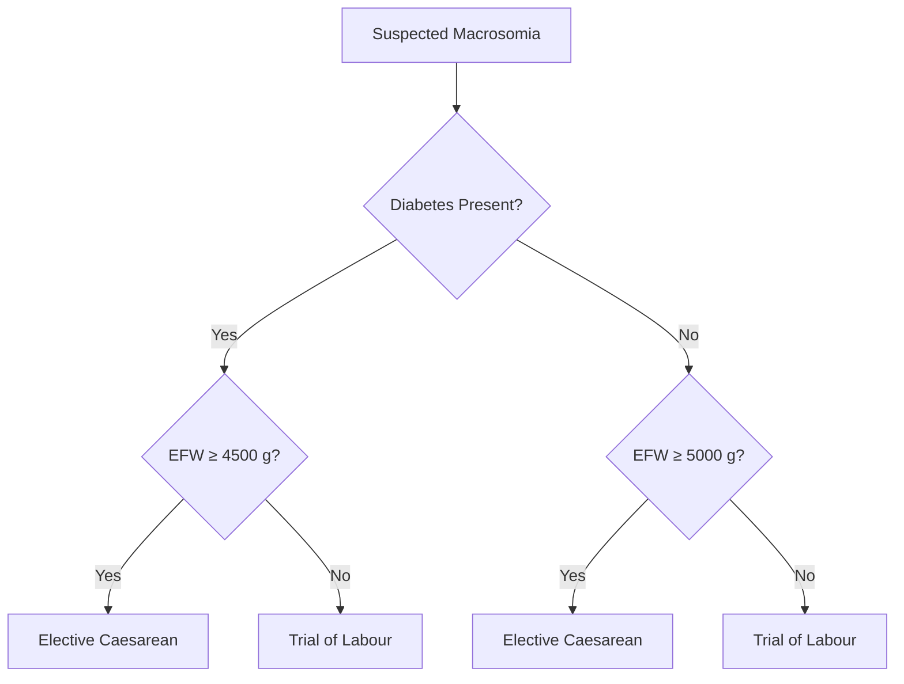

- macrosomia
	- definition
		- birth weight
			- >4000 g
			- OR >4500 g

- large for gestational age (LGA)
	- definition
		- birth weight ≥90th percentile for gestational age

- ultrasound definition
	- estimated fetal weight (EFW) ≥95th percentile
	- OR abdominal circumference ≥95th percentile

- risk factors
	- maternal
		- pre-existing diabetes
		- gestational diabetes
		- obesity / high BMI
		- previous macrosomic baby
		- age >30 years
		- high parity
		- post-term pregnancy
		- excessive weight gain
		- ethnicity

	- fetal
		- male fetus

- complications
	- maternal
		- caesarean delivery
		- prolonged labour
		- postpartum haemorrhage
		- chorioamnionitis
		- 3rd/4th degree perineal tear
		- risk markedly ↑ if birth weight >4500 g

	- fetal
		- shoulder dystocia
		- clavicle fracture
		- brachial plexus injury
			- most resolve by 1 year

	- other risks
		- low Apgar score
		- neonatal hypoglycaemia
		- NICU admission
		- childhood obesity
		- metabolic syndrome later

- prevention
	- regular exercise
	- good glycaemic control
	- universal GDM screening
	- low glycaemic index diet (GDM)
	- optimise pre-pregnancy weight
	- bariatric surgery
		- severe obesity
		- pre-pregnancy

- diagnosis
	- definitive
		- birth weight after delivery

	- antenatal estimation
		- error ±20%

- investigations
	- ultrasound
		- accuracy ↓ as fetal weight ↑

	- fundal height
		- useful to rule out macrosomia
		- poor for confirmation

	- MRI
		- more accurate
		- not routine

- predictor of shoulder dystocia
	- (abdominal circumference – biparietal diameter) ≥2.6 cm

- management
	- timing of delivery
		- induction of labour

			- benefits
				- ↓ shoulder dystocia
				- ↓ neonatal fractures

			- risk
				- early delivery <39 weeks
					- neonatal complications

			- indication
				- EFW ≥95th percentile

	- mode of delivery
		- vaginal delivery
			- macrosomia not a contraindication
			- most deliver without complications

	- elective caesarean thresholds
		- no diabetes
			- EFW ≥5000 g

		- diabetes
			- EFW ≥4500 g

		- rationale
			- reduce brachial plexus injury

- labour management
	- increased shoulder dystocia risk with
		- prolonged labour
		- arrest of descent
		- large fetus

	- red flag
		- EFW >4500 g + labour arrest

- operative vaginal delivery
	- vacuum
		- ↑ shoulder dystocia risk

	- forceps
		- lower risk vs vacuum

	- recommendation
		- experienced operator
		- consider theatre setting

- VBAC
	- macrosomia
		- not absolute contraindication

	- note
		- success ↓ if birth weight ≥4000 g
# AMC Exam Pearls

1. Macrosomia definition:
   >4000 g or >4500 g

2. LGA definition:
   ≥90th percentile

3. Ultrasound error:
   ±20%

4. Elective C-section threshold:
   Diabetes → 4500 g  
   No diabetes → 5000 g

5. Major complication:
   Shoulder dystocia

6. Macrosomia alone ≠ contraindication to VBAC

---

# Clinical Decision Algorithm

