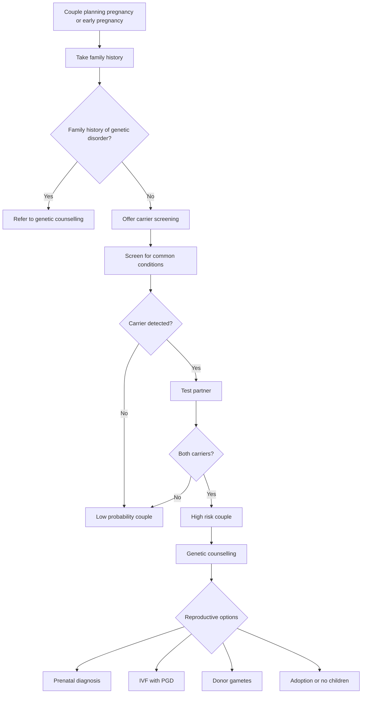

### if Autosomal Recessive
- Both parents carriers → **25% affected child**

### if X-linked
- Mother carrier → **25% affected son**

### Common conditions screened:
- Thalassaemia
- Cystic fibrosis
- Spinal muscular atrophy
- Fragile X syndrome

## indication for screening
- **All couples planning pregnancy** 
	- preferable
- **All women in early pregnancy**

## Initial Assessment

- Take detailed history for Family history of genetic disease, Consanguinity, Ethnic risk factors
	- If family history present
		- → **refer to genetic counselling**
- if high risk ethnicity
	- haemoglobinopathy

## Basic Screening
| test                         | purpose                                                                                                                                                 |
| ---------------------------- | ------------------------------------------------------------------------------------------------------------------------------------------------------- |
| FBE                          | thalassaemia carrier status                                                                                                                             |
| additional carrier screening | Cystic fibrosis, Spinal muscular atrophy, Fragile X syndrome                                                                                            |
| Ashkenazi Jewish ancestry    | Tay Sachs disease, Niemann Pick disease type A, Fanconi anaemia group C, Familial dysautonomia,  Bloom syndrome, Canavan disease, Mucolipidosis type IV |
|                              |                                                                                                                                                         |

# Screening Methods
1. Woman tested first
	1. If carrier → test partner
2. if needed couple screening
	1. both partners tested simultaneously
	2. if carrier couple identified ==> 25% risk of affected child
		1. refer to genetic counselling
3. laboratory testing should report
	- **Class 4 mutations (likely pathogenic)**
	- **Class 5 mutations (pathogenic)**
	- Do NOT report:
		- Variants of uncertain significance (VUS)

# Genetic Carrier Screening Algorithm

---

# AMC Exam Pearls

- Screening ideally **before conception**
- **Autosomal recessive risk = 25% if both carriers**
- Common screening panel:
  - **CF**
  - **SMA**
  - **Fragile X**
- All pregnant women should have **FBE for thalassaemia screening**
- High-risk couples → **genetic counselling**
