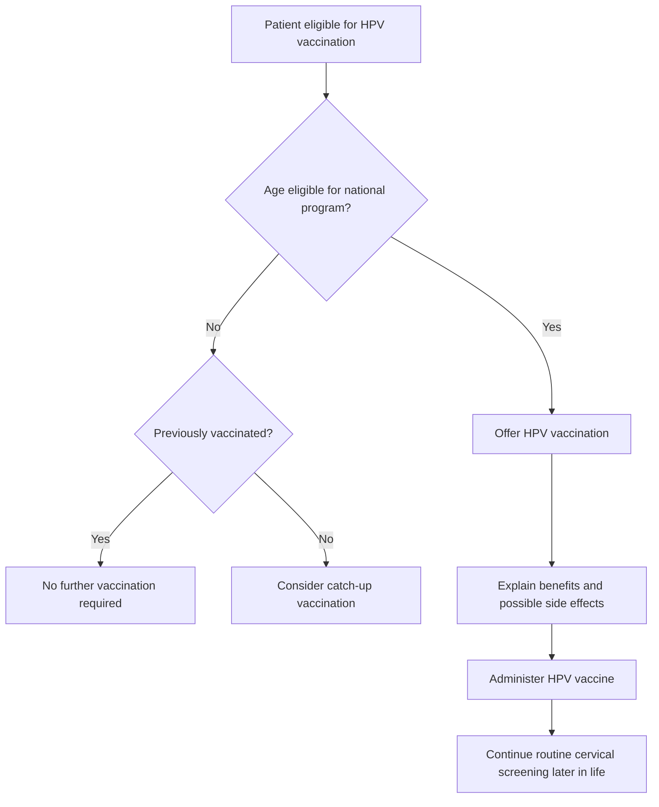

# CA 125
### increased in
- **Primary Concern**
	- Ovarian Cancer (Epithelial)
- **Benign (Common)**
	- Endometriosis
	- Fibroids
	- PID
	- Menstruation
	- adenomyosis
- **Systemic (Common)**
	- Liver Cirrhosis
	- Heart Failure
	- Ascites

### features of malignancy
- rapidly raising one

# cervical cancer
## screening
1. Women and people with a cervix who have ever had sexual contact aged between 25-74 years of age and are eligible for screening should have a HPV screening test for cervical cancer. This can be on a self-collected vaginal sample or on a clinician-collected sample.
	1. Administer one dose of the **9vHPV vaccine** in immunocompetent adolescents and young adults from nine years of age and ensure catch up vaccination up to 26 years

# hpv vaccine
### Free vaccination programs
- Australia: **Age 12–25**
# HPV Vaccination Decision Algorithm

---

# AMC Exam Pearls

- HPV vaccine protects against **9 HPV types**.
- Prevents **HPV infection → cervical cancer → genital warts**.
- Vaccination programs target **pre-sexual exposure adolescents**.
- **Vaccinated women still require cervical screening**.
- Vaccine is **safe and highly effective**.
