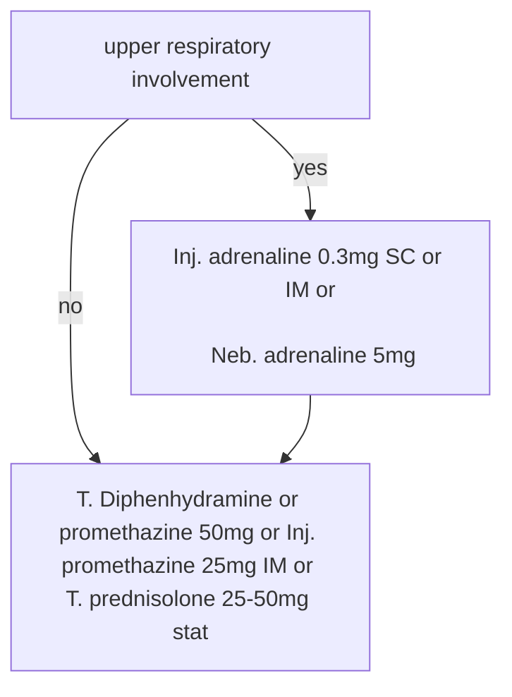

---
words:
  2025-09-08: 163
---
![[Pasted image 20250822161047.jpg]]

![[Pasted image 20260524114106.png]]

![[Pasted image 20250921154610.png]]# Paediatric ACLS
![[Pasted image 20250822161344.jpg]]  

![[Pasted image 20260522163407.png]]

- Signs of respiratory inadequacy
    - Tachypnoea
    - Increased work of breathing
    - Respiratory noises
    - Desaturation
        - SpO2 <92%
    - Reduced chest expansion
    - Reduced air entry
    - Cyanosis
	- Tachycardia
	- Bradycardia
	- Pallor
	- Cool peripheries
	- Altered mental state

- Signs of circulatory inadequacy
    - Tachycardia
    - Bradycardia
    - Hypotension
        - Late/preterminal sign
    - Delayed capillary refill
    - Reduced pulse volume

    - Secondary signs
        - Tachypnoea
            - Especially without increased work of breathing
        - Bradypnoea
        - Altered conscious state
        - Pallor
        - Cyanosis

# BLS
![[Pasted image 20250822155401.jpg]]

# paediatric resuscitation

- Circulation
	- Chest compressions if
		- HR <60 bpm
		- Absent HR

- **Paediatric CPR (ALS)**

	- **Initial assessment**
		- Assess response/signs of life
		- If absent
			- Commence CPR immediately

	- **A – Airway**
		- Optimise head position
			- Infant (<1 year)
				- Neutral position
			- Child (>1 year)
				- Sniffing position
		- Open airway
			- Head tilt–chin lift
			- Jaw thrust (if trauma suspected)
		- Suction
			- Blood
			- Secretions
			- Vomit
		- Airway adjuncts
			- Oropharyngeal airway
			- Nasopharyngeal airway

	- **B – Breathing**
		- Look, listen, feel
		- If apnoeic
			- Give **2 rescue breaths**
			- Bag-valve-mask
			- **100% oxygen**
		- Use **2-person BVM** where possible
	- **C – Circulation**
		- Central pulse
			- Brachial (infants)
			- Carotid/femoral (children)
			- Check ≤10 seconds
		- Start CPR if
			- No pulse
			- HR <60/min with poor perfusion
			- Unsure
	- **Chest compressions**
		- Rate
			- **100–120/min**
		- Depth
			- **1/3 AP chest diameter**
		- Ratio
			- **15:2**
		- If intubated
			- Continuous compressions
				- 100–120/min
			- Ventilation
				- **10 breaths/min**
		- Compression site
			- Lower half of sternum
		- Infant
			- Preferred
				- Two-thumb encircling technique
			- Single rescuer
				- Two-finger technique
		- Child
			- One hand
			- Two hands if required
		- Change compressor
			- Every **2 minutes**
		- Minimise interruptions

	- **Defibrillation**
		- Energy
			- **4 J/kg** (round up)
		- Device preference (<8 years)
			- Manual defibrillator
			- AED with paediatric attenuator
			- Standard AED
		- >8 years
			- Standard AED acceptable
		- Resume CPR immediately after shock
			- 2 minutes before rhythm check

	- **COACHED mnemonic**
		- **C**
			- Compressions continue
		- **O**
			- Oxygen away
		- **A**
			- All clear
		- **C**
			- Charging
		- **H**
			- Hands off
		- **E**
			- Evaluate rhythm
		- **D**
			- Defibrillate or disarm

	- **Drugs**
		- Adrenaline
			- **10 microg/kg IV/IO**
			- Max **1 mg**
		- Amiodarone
			- **5 mg/kg IV/IO**
			- Max **300 mg**
		- Fluids
			- **10–20 mL/kg isotonic crystalloid**
		- Hypoglycaemia
			- **10% glucose 2 mL/kg**
		- Not routinely used
			- Atropine
			- Lidocaine
			- Sodium bicarbonate
			- Calcium

	- **Post-ROSC**
		- Targets
			- SpO₂
				- **94–98%**
			- PaO₂
				- **60–80 mmHg**
			- PaCO₂
				- **35–45 mmHg**
			- SBP
				- >10th percentile for age
			- Temperature
				- **≤37°C**
			- Glucose
				- 4–8 mmol/L

# anaphylaxis
- Clinical features
	- Early danger symptom
		- Itching of palms
		- Itching of soles
	- Skin
		- Urticaria
		- Angioedema
		- Pruritus
			- Generalised
			- Palate
			- Hands
			- Feet
	- Respiratory system
		- wheeze
		- Stridor
	- Gastrointestinal
		- Nausea
		- Vomiting
		- Abdominal pain
		- Diarrhoea
	- Cardiovascular
		- Hypotension
			- Syncope
			- Collapse
		- Palpitations

- Treatment
	- Call for help
	- Remove sting if possible
	- Lay patient down
- 
- O2 8L/min via face mask![[2024-08-08_Anaphylaxis_Flowchart_CS_page-0001.jpg]]
- if [[wheeze]]/stridor
	- salbutomol inhalation ( if severe -> neb)
- Inj. promethazine 25 mg IV
- Inj. Hydrocortisone 250mg IV

![[Pasted image 20250921155744.png]]
- discharge advice
	- T. promethazine 25 mg TDS
	- T.  prednisolone 50mg / day for 3 days
	- [[adrenaline]] auto injector

# angioedema
## definition
- [[Anaphylaxis]] limited to skin, subcutaneous tissue, other specific organs

## treatment
