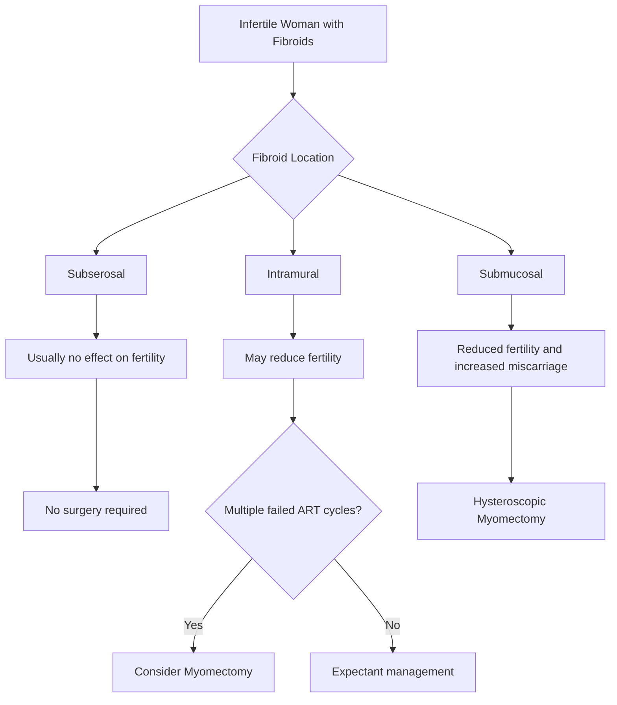

- Dysfunctional uterine bleeding (DUB)
  - Definition
    - Excessively heavy
    - Prolonged
    - Frequent uterine bleeding
    - Not due to pregnancy
    - Not due to pelvic pathology
    - Not due to systemic disease
  - Diagnosis of exclusion
  - Accounts for 40–60% of heavy menstrual bleeding cases

- Heavy menstrual bleeding (menorrhagia)
  - Menstrual blood loss >80 mL per cycle
  - Normal menstrual blood loss <80 mL
  - Consequences
    - Iron deficiency anaemia
    - Social impairment
    - Reduced quality of life

- Types of DUB

  - Ovulatory DUB
    - ~80% of cases
    - Regular cycles
    - Ovulation occurs
    - Heavy bleeding of normal duration
    - Most common in women in their 30s

  - Anovulatory DUB
    - Common at extremes of reproductive age
      - Adolescence
      - Perimenopause
    - Irregular cycles
    - Heavy bleeding
    - Prolonged bleeding
    - Associated with PCOS

- Differential diagnosis

  - Uterine causes
    - Endometrial polyp
    - Endometrial hyperplasia
    - Endometrial carcinoma
    - Fibroids
      - Especially submucosal fibroids
    - Adenomyosis
    - Endometriosis
    - Intrauterine device (especially copper IUD)

  - Systemic causes
    - Hypothyroidism
    - Coagulopathy
      - Von Willebrand disease
    - Chronic kidney disease
    - Bleeding disorders

- Red flags
  - Intermenstrual bleeding
    - Endometrial pathology
    - Cervical pathology
  - Postcoital bleeding
    - Cervical cancer
    - Cervicitis
    - Chlamydia infection
  - Malignancy must always be excluded

- Clinical assessment

  - History
    - Menstrual pattern
    - Duration of bleeding
    - Volume of bleeding
    - Presence of clots
    - Intermenstrual bleeding
    - Postcoital bleeding
    - Impact on quality of life
    - Contraceptive use
    - Previous treatments

  - Features suggesting heavy menstrual bleeding
    - Bleeding >7 days
    - Flooding through pads/tampons
    - Large clots (>3 cm)
    - Symptoms of anaemia
    - Increased menstrual volume

- Investigations

  - Pregnancy test
    - First investigation in reproductive-age women

  - Full blood examination (FBE)
    - Assess anaemia

  - Ferritin
    - Assess iron deficiency

  - Cervical screening
    - Pap test/co-test if indicated

  - Pelvic ultrasound
    - Exclude structural pathology
    - Fibroids
    - Polyps
    - Adenomyosis

  - Coagulation studies
    - Particularly adolescents
    - Suspected bleeding disorder
    - Von Willebrand disease

  - Additional investigations if indicated
    - Thyroid function tests
    - Renal function tests
    - Autoimmune investigations

  - Endometrial assessment
    - Endometrial biopsy
    - Hysteroscopy
    - Dilation and curettage (D&C)
    - Used diagnostically, not therapeutically

- Medical management

  - Iron replacement
    - Treat iron deficiency anaemia

- NSAIDs
  - Examples
    - Mefenamic acid
  - Mechanism
    - Reduce prostaglandin levels
  - Benefits
    - Reduce blood loss by ~30%
    - Reduce dysmenorrhoea
  - Side effects
    - Nausea
    - Vomiting
    - Dyspepsia
    - Diarrhoea
  - Contraindications
    - Peptic ulcer disease
    - NSAID allergy
    - Some patients with asthma

- Tranexamic acid
  - Antifibrinolytic
  - First-line treatment for ovulatory DUB
  - Reduces menstrual blood loss by 45–60%
  - Used only during heavy bleeding days
  - Side effects
    - Nausea
    - Leg cramps
  - Rare complication
    - Thrombosis

- Levonorgestrel-releasing IUD (Mirena)
  - Most effective medical treatment
  - Reduces blood loss up to 97% after 12 months
  - Effective for
    - Ovulatory DUB
    - Anovulatory DUB
  - Also provides contraception
  - Effective for 5 years
  - Side effects
    - Initial irregular bleeding

- Combined oral contraceptive pill (COCP)
  - Reduces blood loss by up to 50%
  - Additional benefits
    - Contraception
    - Reduced dysmenorrhoea

- Progestogens

  - First-line for anovulatory DUB

  - Cyclical regimen
    - Usually day 15–25 of cycle

  - Ovulatory DUB
    - Day 5–25 regimen

  - Acute heavy bleeding
    - Norethisterone ≥15 mg/day
    - Medroxyprogesterone acetate ≥30 mg/day
    - Continue until bleeding stops
    - Then maintenance therapy

- Other hormonal treatments

  - Danazol
    - Effective
    - Limited by side effects
      - Weight gain
      - Acne
      - Depression
      - Voice changes

  - GnRH agonists
    - Limited role
    - Pre-operative use
    - Maximum ~6 months
    - Causes temporary menopause
    - Risk of osteoporosis

- Surgical management

  - Indications
    - Failed medical therapy
    - Significant symptoms
    - Patient preference

  - Endometrial ablation
    - Destroys endometrium
    - Effective for DUB
    - Not contraceptive
    - Avoid if future fertility desired

  - Hysterectomy
    - Definitive treatment
    - Guarantees amenorrhoea
    - Highest morbidity
    - Consider when childbearing complete

- Abnormal bleeding recommendations

  - Intermenstrual bleeding (IMB)
    - Cervical screening/co-test
    - Pelvic ultrasound
    - Gynaecology referral if persistent

  - Postcoital bleeding (PCB)
    - Exclude cervical cancer
    - Test for chlamydia
    - Persistent/recurrent PCB requires gynaecology referral

- AMC high-yield points

  - DUB is a diagnosis of exclusion
  - Most common cause of heavy menstrual bleeding is DUB
  - Ovulatory DUB = regular heavy periods
  - Anovulatory DUB = irregular heavy periods
  - Adolescents with heavy bleeding → consider Von Willebrand disease
  - First-line investigation = pregnancy test + FBE
  - Pelvic ultrasound excludes structural causes
  - Tranexamic acid is first-line for ovulatory DUB
  - Levonorgestrel IUD is the most effective medical therapy
  - Progestogens are first-line for anovulatory DUB
  - Endometrial ablation unsuitable for women desiring future fertility
  - Persistent intermenstrual or postcoital bleeding requires investigation for malignancy

- Abnormal bleeding in women using contraception
  - Bleeding changes are common with contraceptive use
  - Always exclude pathology before attributing bleeding to contraception

- Important causes to exclude
  - Pregnancy
    - Intrauterine pregnancy
    - Ectopic pregnancy
    - Miscarriage
    - Gestational trophoblastic disease
  - Cervicitis
  - Pelvic inflammatory disease (PID)
  - Endometriosis
  - Endometrial polyp
  - Fibroids
  - Malignancy

- Assessment
  - History
  - Pelvic examination
  - Appropriate investigations
  - Determine if specialist referral required

- Factors contributing to contraceptive-related bleeding
  - Poor adherence
    - Missed pills
    - Late pills
  - Poor gastrointestinal absorption
    - Vomiting
    - Severe diarrhoea
    - Malabsorption
  - Endometrial instability
  - Smoking
  - Enzyme-inducing medications
    - Some antiepileptics
    - Rifampicin
    - Some HIV medications
    - St John's Wort
    - Bosentan
    - Modafinil
    - Aprepitant
    - Sugammadex

- Antibiotics
  - Most broad-spectrum antibiotics do NOT affect hormonal contraception
  - Additional contraception usually not required
  - Exception
    - Significant diarrhoea/vomiting

- Combined hormonal contraception (COCP)

  - Mechanism
    - Progestogen provides contraceptive effect
    - Oestrogen stabilises endometrium

  - Breakthrough bleeding (BTB)
    - Common in first 3–4 months
    - Up to 30% in first cycle
    - ~10% still affected at 12 months

  - BTB does NOT indicate reduced efficacy if
    - No missed pills
    - No vomiting
    - No drug interactions

- Management of persistent BTB on COCP (>3 months)

  - Change progestogen
    - Gestodene-containing pill
    - Norethisterone-containing pill

  - Increase oestrogen dose
    - Change from 20 μg EE to 30–40 μg EE

  - Consider oestradiol-containing pill

  - Change delivery system
    - Vaginal ring
    - Better cycle control than many COCPs

  - Triphasic pills
    - No proven advantage over monophasic pills

- Extended-cycle COCP use
  - Monthly withdrawal bleeding not medically necessary
  - Continuous active pills may be used
  - Increased BTB common
  - If BTB ≥3 days
    - Stop active hormones for 4 days
    - Then restart

- Progestogen-only contraception

  - Includes
    - Progestogen-only pill (POP)
    - Levonorgestrel IUD
    - Etonogestrel implant
    - Depot medroxyprogesterone injection (DMPA)

  - Key counselling point
    - Irregular bleeding is common
    - Bleeding often unpredictable

- Amenorrhoea rates

  - Levonorgestrel IUD
    - ~50% at 12 months

  - DMPA injection
    - ~50% at 12 months

  - Implant
    - ~20%

- Progestogen-only pill (POP)

  - Contains
    - Norethisterone
    - Levonorgestrel

  - About 40% continue ovulating
    - Regular bleeding possible

  - Others may experience
    - Amenorrhoea
    - Irregular spotting
    - Frequent bleeding

  - Must be taken within 3 hours of usual time
  - Pregnancy should be excluded if bleeding pattern changes significantly

- Long-acting reversible contraception (LARC)

  - Includes
    - Hormonal IUD
    - Implant
    - DMPA injection

  - Exclude
    - Pregnancy
    - Infection
    - Pathology

- Hormonal IUD and bleeding

  - Irregular bleeding common initially

  - Consider malposition if
    - Bleeding plus pain
    - Long strings (>4 cm from cervical os)

  - Investigation
    - Pelvic ultrasound

- Management of irregular bleeding on LARC

  - First-line

    - Combined hormonal contraceptive
      - Continuous or cyclic
      - Up to 3 months

    - NSAID
      - Mefenamic acid 500 mg BD/TDS for 5 days

    - Tranexamic acid
      - 500 mg BD for 5 days

  - Second-line

    - Norethisterone
      - 5 mg TDS for 21 days

  - Not recommended
    - Doxycycline

- Additional practical measures

  - Early replacement of implant or LNG-IUD may help
  - DMPA interval can sometimes be shortened to 10 weeks

- Copper IUD

  - Hormone-free contraception

  - Bleeding effects
    - Increased menstrual volume
    - Increased duration of bleeding
    - Irregular spotting common initially

  - Menstrual blood loss
    - Increases by approximately 50–55%

  - Management
    - NSAIDs
    - Tranexamic acid

  - Consider partial expulsion if
    - Bleeding
    - Pelvic pain
    - Dyspareunia

- AMC high-yield points

  - Always exclude pregnancy in women with abnormal bleeding on contraception
  - BTB is common in first 3 months of COCP use
  - BTB alone does not indicate contraceptive failure
  - Levonorgestrel IUD and DMPA have highest rates of amenorrhoea
  - Implant has highest rate of irregular bleeding
  - Pain + bleeding + long IUD strings suggests partial expulsion
  - Pelvic ultrasound is indicated if IUD malposition suspected
  - Copper IUD commonly increases menstrual bleeding
  - NSAIDs and tranexamic acid are useful for heavy bleeding with copper IUDs

# fibroid
## Types of Fibroids
- **Subserosal (SS)** → Outside uterus
- **Intramural (IM)** → Within uterine wall
- **Submucosal (SM)** → Inside uterine cavity

## factors influencing fertility outcome
- Fibroid **position, size, and number**

# Effect of Fibroid Location on Fertility

| Fibroid Type | Effect on Fertility                                  | Treatment Impact              |
| ------------ | ---------------------------------------------------- | ----------------------------- |
| Subserosal   | No significant effect                                | Surgery usually not required  |
| Intramural   | May reduce fertility and ↑ miscarriage               | Benefit of surgery uncertain  |
| Submucosal   | ↓ fertility and ↑ miscarriage (==strongest impact==) | Myomectomy improves fertility |

---

## Investigations

### Goal
**Exclude uterine cavity distortion**

### Preferred investigations:
- **MRI**
- **Sonohysterography**
- **Hysteroscopy**

### Less reliable:
- Transvaginal ultrasound
- Hysterosalpingography

---

## Surgical Options

### surgery
- **Myomectomy**

### Indications for Myomectomy

1. **Submucosal fibroids in infertile women**
2. **Symptomatic fibroids**
   - Heavy bleeding
   - Pressure symptoms
1. **Multiple failed ART cycles with intramural fibroids**

### Approach depends on fibroid location:
- Hysteroscopic
- Laparoscopic
- Laparotomy

---

# Treatments NOT Recommended for Fertility
- Uterine artery embolisation (UAE)
- MR-guided focused ultrasound
- Myolysis
- Radiofrequency ablation

# Medical Therapy

Medical treatment **not recommended for infertility** because it delays conception.

### Not recommended:
- **Ulipristal acetate**

# Clinical Decision Algorithm

---

# AMC Exam Pearls

- **Submucosal fibroids → strongest negative fertility impact**
- **Hysteroscopic myomectomy improves fertility**
- **Subserosal fibroids usually do not affect fertility**
- **Medical therapy not recommended for infertility**
- **Best evaluation for cavity distortion: MRI / sonohysterography / hysteroscopy**
